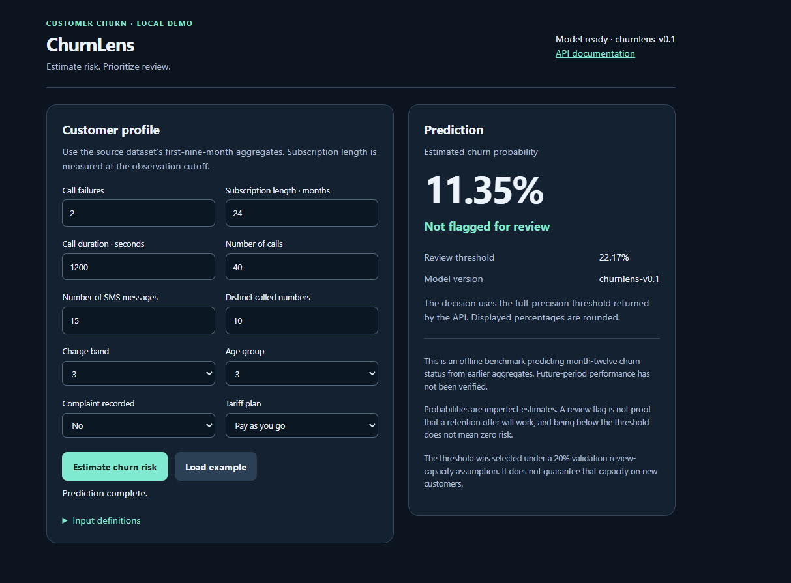
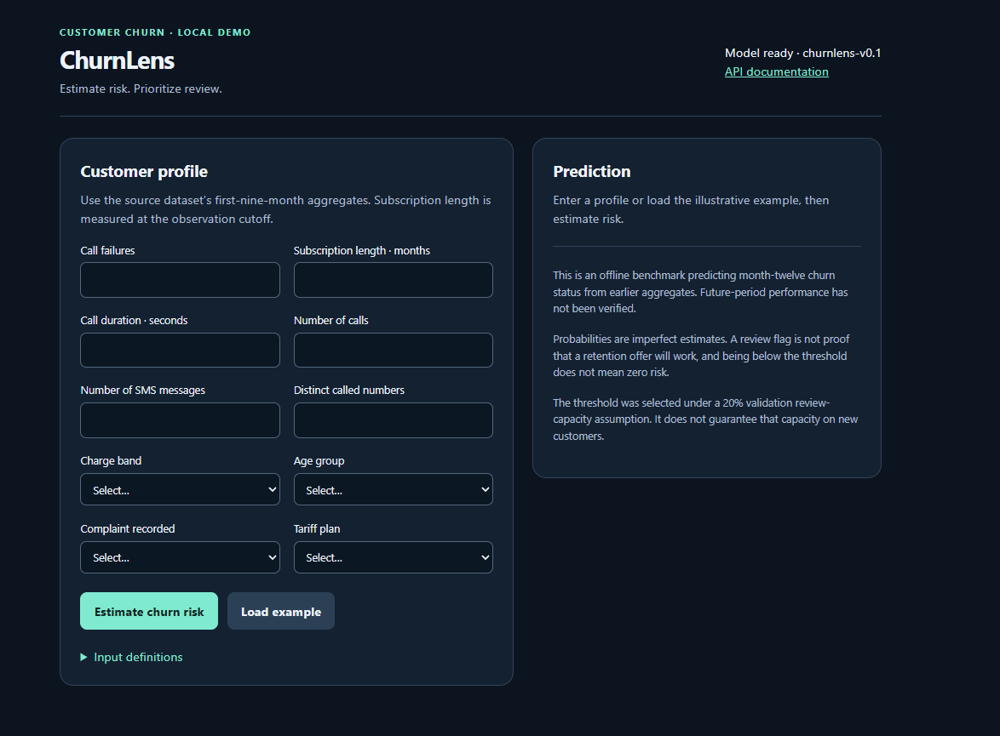

# ChurnLens

Customer-churn prediction with grouped evaluation, baseline comparisons,
probability-calibration experiments, and validated FastAPI serving.

ChurnLens is a local portfolio MVP built around the UCI Iranian Churn
dataset. It estimates month-twelve churn status from documented earlier
customer aggregates and applies a frozen threshold to prioritize review.

**Verified:** 78 tests passed in a fresh Git worktree using a separately
installed Python 3.11.3 environment and the committed frozen model.

## Demo




## What it demonstrates

- Dataset validation, source checksums, and duplicate-profile detection.
- Separation of training, validation, and final-test responsibilities.
- Dummy, logistic-regression, and random-forest comparisons.
- Training-only grouped cross-validation and sigmoid calibration.
- Validation-based threshold selection under a review-capacity assumption.
- Error analysis with slice sizes and class denominators.
- Frozen preprocessing and model artifacts with integrity checks.
- Strict input validation, FastAPI endpoints, and a browser interface.

## Final-test results

The selected model is an uncalibrated random forest with 300 trees,
maximum depth 8, and minimum leaf size 5.

The final test contains **631 rows**, including **95 churners**.

| Metric | Result |
|---|---:|
| Average precision | 0.8872 |
| ROC-AUC | 0.9723 |
| Brier score | 0.0488 |
| Log loss | 0.1699 |
| Precision at frozen threshold | 71.55% |
| Recall at frozen threshold | 87.37% |
| F1 at frozen threshold | 0.7867 |
| Customers flagged | 116 / 631 — 18.38% |

At threshold **0.2216680816787302**, the model caught 83 churners,
missed 12, and incorrectly flagged 33 non-churners.

Confusion matrix, with actual classes as rows and predicted classes
as columns:

| | Not flagged | Flagged |
|---|---:|---:|
| Non-churn | 503 | 33 |
| Churn | 12 | 83 |

The model and threshold were frozen before final-test evaluation.

See [the final-test report](reports/final_test.json).

## Run locally

### Requirements

- Python **3.11.3**.
- Git and Windows Command Prompt for the instructions below.
- CPU execution; no GPU, paid API, or hosted service is required.

The frozen loader currently enforces the exact recorded Python patch
version and numerical-library versions. Other environments have not
been verified.

From the repository root:

```bat
py -3.11 -m venv .venv
.venv\Scripts\activate
python --version
python -m pip install -r requirements.txt
python -m pip check
python -m pytest -q
python -m uvicorn churnlens.api:app --host 127.0.0.1 --port 8000
```

Confirm that `python --version` prints `Python 3.11.3`.

Open:

- Browser interface: http://127.0.0.1:8000/
- API documentation: http://127.0.0.1:8000/docs
- Health endpoint: http://127.0.0.1:8000/health

The committed frozen bundle supports serving without downloading the
training CSV.

In the interface, select **Load example**, then **Estimate churn risk**.
The verified example produces approximately **11.35%** estimated risk
and is not flagged for review.

## API

### `GET /health`

Reports readiness and the loaded model version.

### `POST /predict`

Accepts one customer profile:

```json
{
  "call_failure": 2,
  "subscription_length": 24,
  "seconds_of_use": 1200,
  "frequency_of_use": 40,
  "frequency_of_sms": 15,
  "distinct_called_numbers": 10,
  "charge_amount": 3,
  "age_group": 3,
  "complains": 0,
  "tariff_plan": 1
}
```

Returns:

- `model_version`
- `churn_probability`
- `threshold`
- `flagged_for_review`

All ten fields are required. Integer fields reject strings, fractional
values, booleans, and nulls. Invalid category codes and unexpected fields
are rejected with HTTP 422.

The large numeric ceiling is an engineering guard, not a validated
range of model applicability.

The service loads the frozen pipeline once at startup, verifies its
integrity and environment, and preserves training feature order.
It does not retrain during requests.

## Dataset and prediction task

Source: [UCI Iranian Churn](https://archive.ics.uci.edu/dataset/563/iranian+churn+dataset).

Citation: Iranian Churn [Dataset]. (2020). UCI Machine Learning Repository.
https://doi.org/10.24432/C5JW3Z.

Dataset license: [CC BY 4.0](https://creativecommons.org/licenses/by/4.0/).
This attribution concerns the dataset; it does not assign a license
to the project source code.

UCI describes inputs aggregated over the first nine months and churn
status measured at the end of month twelve. The target is `1` for churn
and `0` otherwise.

The downloaded snapshot contains:

- 3,150 rows and 13 input columns.
- 495 churners and 2,655 non-churners.
- No missing cells detected by the audit.
- 300 duplicate full rows beyond the first occurrence.
- 14 groups with identical original inputs but conflicting labels.
- No customer identifier or timestamp columns.

The raw CSV is preserved unchanged. Column names are normalized in
memory, and ten inputs are selected for modeling.

`status`, `customer_value`, and `age` are excluded. These exclusions
reflect ambiguous availability/calculation and redundant age
representation; they are not proof that those fields leak.

Charge band 10 occurs in the data although the documentation describes
0–9. It is retained and documented.

## Evaluation design

Identical profiles across the ten selected model inputs remain together.
This produces 2,826 profile groups.

| Partition | Rows | Groups |
|---|---:|---:|
| Training | 1,883 | 1,687 |
| Validation | 636 | 570 |
| Final test | 631 | 569 |

There is zero profile overlap across partitions.

Preprocessing is fitted inside model pipelines. Training cross-validation
and calibration also respect profile groups.

### Baselines and calibration

| Validation candidate | Average precision | ROC-AUC | Brier score | Log loss |
|---|---:|---:|---:|---:|
| Dummy prior | 0.1557 | 0.5000 | 0.1314 | 0.4325 |
| Logistic, raw | 0.8128 | 0.9361 | 0.061684 | 0.211150 |
| Logistic, sigmoid | 0.8128 | 0.9361 | 0.061540 | 0.210520 |
| Forest, raw | 0.8951 | 0.9765 | **0.047026** | **0.163980** |
| Forest, sigmoid | 0.8951 | 0.9765 | 0.048517 | 0.166015 |

Sigmoid calibration used out-of-fold predictions from training rows.
The raw forest was retained because it had the lowest validation log
loss and Brier score among the compared candidates.

### Review threshold

The threshold maximizes validation true positives while flagging at most
20% of validation rows. Equal-recall choices prefer fewer flags, and
equal scores are kept together.

This hypothetical capacity policy selected 124 of 636 validation rows.
A fixed threshold does not guarantee a 20% flag rate on new data.

## Error analysis and limitations

- This is a single-dataset offline benchmark, not a production-ready
  retention system.
- No timestamps are available for a chronological split. Future-period
  and cross-operator performance are unverified.
- Profile grouping cannot establish unique customer identities.
- The precise operational churn rule and eligibility of currently
  active customers are not fully established.
- Probabilities remain imperfectly calibrated. On the test set, the
  lowest-risk bin averaged 5.09% predicted risk versus 1.97% observed churn.
- In validation, customers with at most 1,000 seconds of use accounted
  for 25 of 33 false positives.
- Some slices contain few or no churners. Their rates do not support
  strong subgroup conclusions or fairness guarantees.
- Churn risk does not establish whether an intervention will work or
  how much revenue it will save.
- No authentication, rate limiting, or public hosting is included.

## Tests and reproducibility

The 78 tests cover dataset auditing, grouped splits, preprocessing,
calibration mechanics, threshold selection, request validation,
artifact integrity, prediction persistence, and API behavior.

Verification completed:

- Installation from the pinned dependency file in a fresh environment.
- No broken requirements reported by `pip check`.
- All 78 tests passing from a separate Git worktree.
- Manual HTTP 200 prediction and HTTP 422 invalid-input checks.
- Browser example prediction from the separate checkout.

Browser interaction is not covered by automated browser tests.

Eight dependency deprecation warnings were observed: seven from
SciPy solver options and one from Starlette's HTTPX test-client usage.

The frozen model, decision, and historical dependency snapshot are
included under `artifacts/frozen/`. Their checksums are recorded in
`reports/frozen_model_manifest.json`.

`.gitattributes` preserves checksum-sensitive file bytes. A newline
conversion issue was found during fresh-checkout testing and corrected
before that check passed.

This verifies the packaged serving path. Byte-identical end-to-end
retraining from a fresh checkout has not been verified.

## Training source and reports

Training and evaluation scripts are included under `scripts/`.
The original CSV is not committed.

For dataset inspection, download the UCI archive and place its CSV at:

```text
data/raw/customer_churn.csv
```

Expected SHA-256:

```text
90d5fb6bd1630cd4de4b4d28fcf8b4cb92a8f6ab7484605b0799d47386f7dbe1
```

The experimental sequence was:

1. Audit the dataset and define model features.
2. Create fixed grouped splits.
3. Train baselines and the tree challenger.
4. Compare raw and calibrated probabilities.
5. Select the validation threshold and analyze errors.
6. Freeze the model and decision.
7. Evaluate the final test set.

Several scripts intentionally refuse to overwrite existing decision or
evaluation files. Training reproduction should use a separate experiment
directory and preserve the published release.

Key reports:

- [Dataset audit](reports/data_audit.json)
- [Split summary](reports/split_summary.json)
- [Baseline validation](reports/baseline_validation.json)
- [Challenger evaluation](reports/challenger_validation.json)
- [Calibration comparison](reports/calibration_validation.json)
- [Threshold selection](reports/threshold_validation.json)
- [Validation error analysis](reports/validation_error_analysis.json)
- [Frozen manifest](reports/frozen_model_manifest.json)
- [Final test](reports/final_test.json)